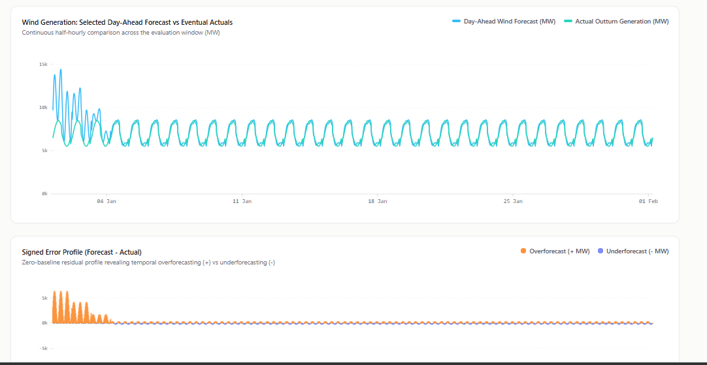
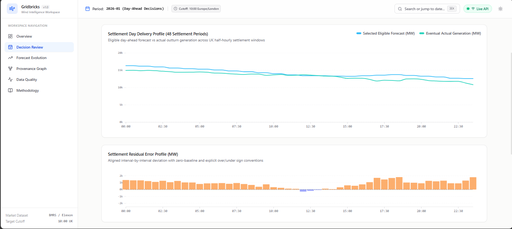
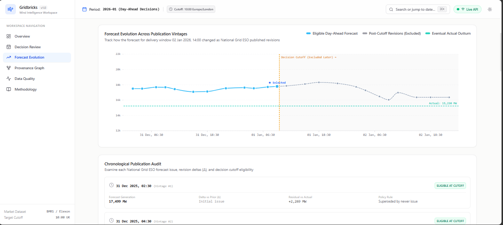
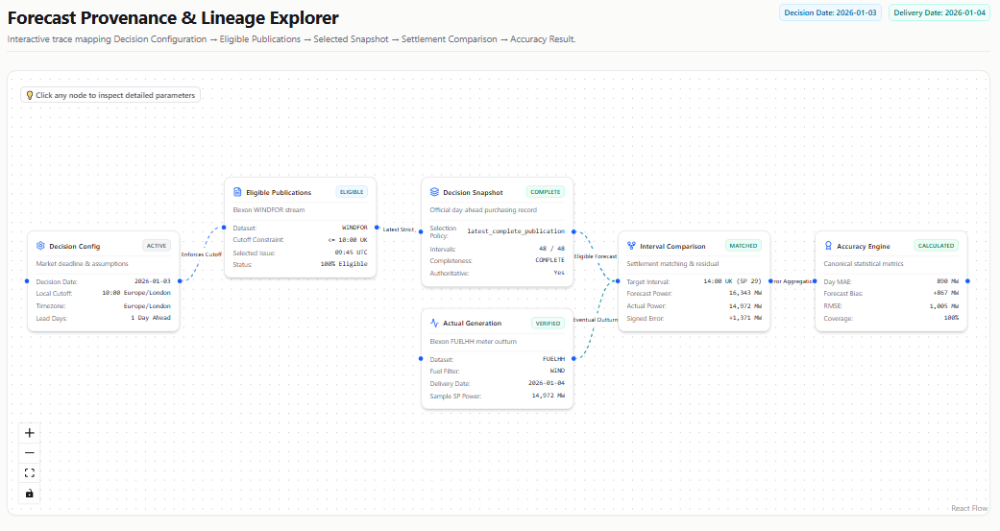

Wind intelligence. Without the guesswork.

## platform overview

Explore the platform · Get started · Architecture

## The idea

A forecast published after a procurement deadline shouldn't influence the analysis of an earlier decision.

Gridbricks makes that boundary explicit.

01 Reconstruct — recover the forecast available at decision time.

02 Compare — measure it against actual half-hourly generation.

03 Explain — trace forecast selection, revisions, errors, and data quality.

No hindsight bias. No invisible assumptions. Just auditable evidence.

## The workspace

Explore the platform through six connected views.

View	What you can do
Overview	Track MAE, RMSE, bias, WAPE, and P90 error.
Decision audit	Inspect all 48 settlement periods for a UK day.
Forecast evolution	Compare forecast vintages against the decision cutoff.
Provenance	Trace how each historical result was produced.
Data quality	Inspect source freshness, ingestion, and missing data.
Methodology	Understand metrics, units, and eligibility rules.

!Forecast analytics dashboard

!Settlement-level decision analysis

!Forecast provenance and data exploration

Built around one principle

The past must remain reproducible.

Time-aware: enforce the configured Europe/London decision cutoff.
Leakage-resistant: exclude forecasts published after the deadline.
Traceable: connect source publications to selected snapshots and analytical results.
Deterministic: reproduce snapshots from the same source data and configuration.
Transparent: expose missing observations, forecast revisions, and data-quality limitations.

Forecasts and actuals are represented in MW. Energy calculations account for settlement duration. Metric formulas and residual conventions are defined by the backend.

The default 10:00 cutoff is a placeholder until the procurement deadline is formally confirmed.
Under the hood

<pre>
Elexon BMRS
│
▼
Ingestion & Normalisation
│
▼
Historical Forecast Snapshots
│
▼
Accuracy & Bias Analytics
│
▼
FastAPI ───────── React + TypeScript
│
▼
Analyst Workspace
</pre>

Layer	Stack
API	Python 3.12+, FastAPI, Granian, Pydantic
Data	PostgreSQL / Neon, SQLAlchemy, Alembic
Analytics	Pandas-free domain services, deterministic snapshot selection
Integrations	Elexon BMRS, Redis, QStash, Hugging Face-hosted Llama
Frontend	React 19, TypeScript, Vite 8
Visualisation	D3.js, XYFlow, Tailwind CSS 4
Testing	pytest, Ruff, Vitest, React Testing Library
Deployment	Docker, Nginx

## Development tools
Used AI tools including Antigravity and ChatGPT to speed up development, code, documentation and testing.

Actual dependency usage and optional integrations are defined by the project manifests and configuration.

## Get started

Requirements: Python 3.12+, uv, Node.js 20+, npm 10+.

1. Clone
bash
git clone <repository-url>
cd gridbricks

2. Start the backend
bash
cd backend

uv venv
uv pip install -e ".[dev]"

cp .env.example .env
uv run alembic upgrade head

uv run granian --interface asgi app.main:app \
  --host 127.0.0.1 \
  --port 8000 \
  --reload

Configure backend/.env before starting. Use the database and credentials appropriate for your environment.

API: localhost:8000 · Swagger UI

3. Start the frontend

In a second terminal:

bash
cd frontend
npm install

Set VITE_API_BASE_URL=http://localhost:8000 in frontend/.env.local, then run:

bash
npm run dev

Open localhost:5173.

4. Verify
bash
# Backend
cd backend
uv run python -m app.cli check-config
uv run python -m app.cli check-source-connectivity
uv run pytest tests/ --cov=app --cov-report=term-missing
uv run ruff check .
uv run ruff format --check .

# Frontend — run from frontend/
npm test
npm run build

Check the configured frontend scripts before running optional commands such as type-checking.

Operational toolkit

Run from backend/.

Task	Command
Ingest actuals	uv run python -m app.cli ingest-actuals --from-date YYYY-MM-DD --to-date YYYY-MM-DD
Ingest forecasts	uv run python -m app.cli ingest-forecasts --decision-from YYYY-MM-DD --decision-to YYYY-MM-DD
Rebuild snapshots	uv run python -m app.cli rebuild-snapshots --decision-from YYYY-MM-DD --decision-to YYYY-MM-DD
Audit data quality	uv run python -m app.cli data-quality-report --decision-from YYYY-MM-DD --decision-to YYYY-MM-DD

Validate CLI options and the target environment before running ingestion or rebuilds against production data.

Repository map
text
gridbricks/
├── backend/
│   ├── app/
│   │   ├── api/           # REST endpoints
│   │   ├── core/          # Configuration and domain rules
│   │   ├── db/            # Models and sessions
│   │   ├── repositories/  # Persistence
│   │   ├── schemas/       # Validation contracts
│   │   ├── services/      # Ingestion, snapshots, metrics
│   │   └── cli.py         # Operational commands
│   ├── migrations/
│   ├── tests/
│   └── docs/
├── frontend/
│   └── src/
│       ├── features/      # Analyst workflows
│       ├── charts/        # Visualisations
│       ├── components/    # Shared UI
│       ├── services/      # API integration
│       └── test/
└── README.md

Backend and frontend can be built and deployed independently.

Production is a different standard

Before deployment, verify:

Approved procurement cutoff and timezone rules.
Historical snapshot and daylight-saving regression tests.
Database migrations, backups, and recovery procedures.
Authentication, authorisation, and secrets management.
Monitoring for stale sources, ingestion failures, and data gaps.
Clear separation between live data and demo fixtures.
Independently validated analytical results.

A running application is not proof of complete data or production readiness.

Engineering docs

Detailed implementation and operational guidance lives alongside the code:

backend/docs/ — architecture, data dictionary, metric formulas, API specification, operations, and testing.
backend/README.md — backend setup and implementation.
frontend/README.md — frontend setup and implementation.
Scope

Gridbricks is a retrospective analytics and audit platform — not an automated trading system or a guarantee of forecast performance.

License

No license is currently specified. Add the appropriate license before public distribution.