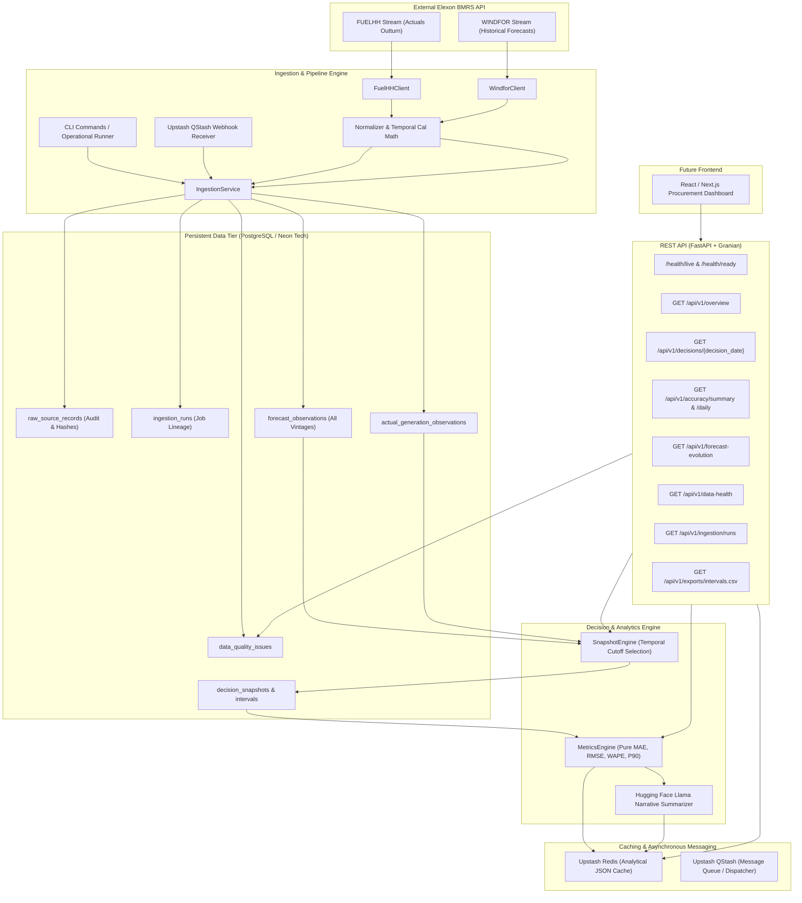
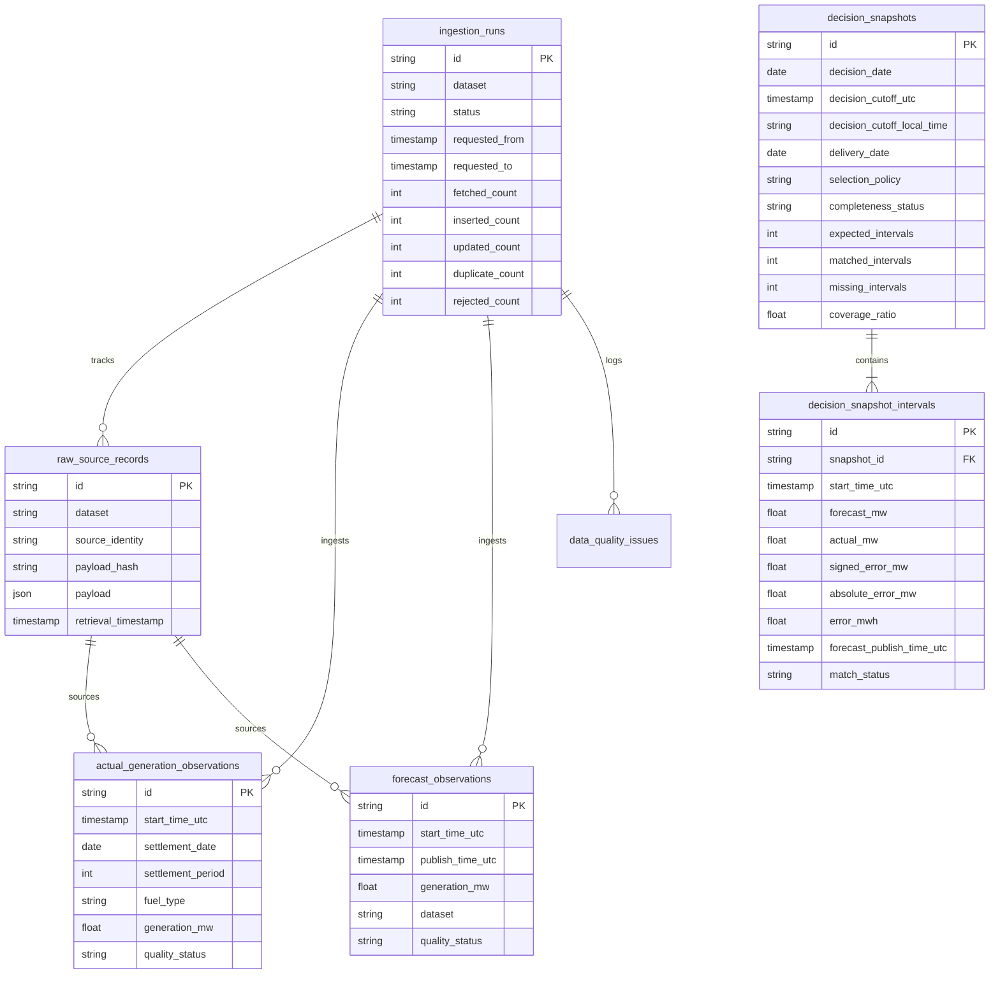

# Gridbricks Backend Architecture Specification

Gridbricks is a high-reliability analytics backend engineered for a UK energy utility's day-ahead electricity procurement team. It determines which national wind generation forecast was available at historical purchasing cutoffs and quantifies the forecast error relative to eventual actual outturn generation.

---

## 1. High-Level Architecture Overview

---

## 2. Core Subsystems

### 2.1 Elexon Source Clients (`app/services/elexon/`)
- **`FuelHHClient`**: Communicates with `/datasets/FUELHH/stream`. Filters to `fuelType = WIND`, parses settlement periods (1–48), and validates average MW power.
- **`WindforClient`**: Communicates with `/datasets/WINDFOR/stream` using bounded publication windows (`publishDateTimeFrom`, `publishDateTimeTo`). Preserves `publishTime` separately from `startTime`.
- **`ElexonBaseClient`**: Shared HTTP layer with bounded retries (`tenacity`), exponential backoff, rate limit header handling, and custom User-Agent.

### 2.2 Data Ingestion & Auditing (`app/services/ingestion/`)
- Every ingestion creates an `IngestionRun` record tracking duration, status, record counts, and errors.
- Every source payload is hashed (SHA-256) and archived in `raw_source_records` for lineage tracking.
- Idempotent upsert strategies guarantee repeated runs never duplicate observations.

### 2.3 Snapshot Selection Engine (`app/services/snapshots/`)
- The core business engine responsible for historical decision integrity.
- Given a decision date (e.g. 2026-01-15):
  1. Computes local purchasing cutoff instant in `Europe/London` (e.g. 10:00) and converts to UTC.
  2. Derives delivery date (e.g. 2026-01-16) and generates expected delivery calendar intervals.
  3. Queries forecasts published **at or before cutoff**.
  4. Excludes all later forecasts to eliminate future lookahead bias.
  5. Selects the `latest_complete_publication` (or falls back to `latest_per_interval`).
  6. Matches with eventual actual outturn and persists `decision_snapshot_intervals`.

### 2.4 Analytics & Metrics Engine (`app/services/metrics/`)
- Pure, independently testable mathematical routines.
- Evaluates Mean Absolute Error (MAE), Root Mean Squared Error (RMSE), Bias, Weighted Absolute Percentage Error (WAPE), and 90th percentile absolute error (P90) strictly over valid matched intervals.

### 2.5 Integrations: Neon Tech, Upstash, and Hugging Face
- **Neon Tech DB**: Serverless PostgreSQL connection pooling (`pool_pre_ping=True`, `pool_recycle=300`) with SSL mode `require`.
- **Upstash Redis**: Caches expensive monthly overviews and accuracy summaries with automatic in-memory TTL fallback.
- **Upstash QStash**: Dispatches background ingestion/backfill tasks and provides webhook signature verification.
- **Hugging Face Llama**: Translates raw numerical forecast accuracy metrics into colloquial, plain-English executive explanations for procurement traders.

---

## 3. Database Entity Relationship Diagram

